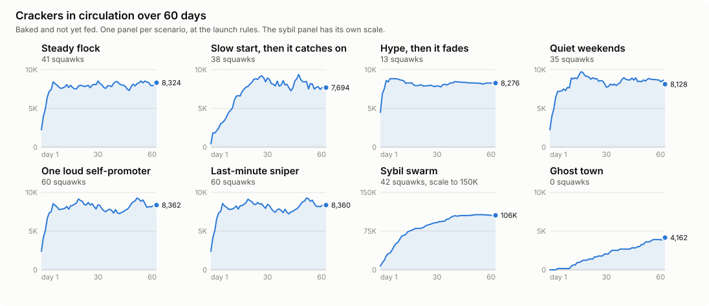
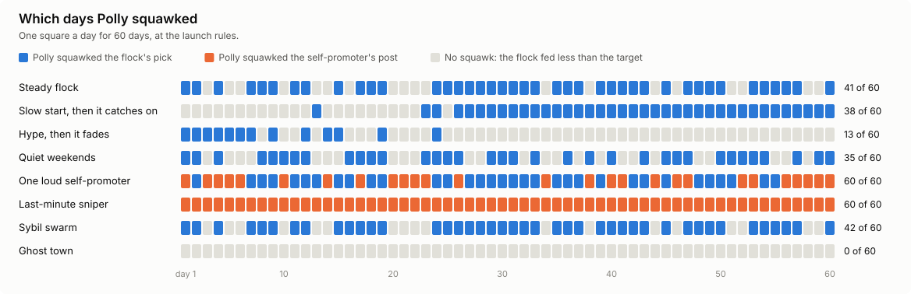
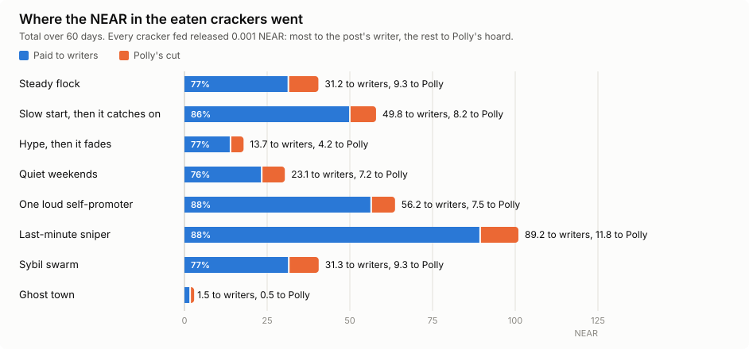

# Sixty days of SQUAWK, simulated

The track asks for 60 days of community behaviour to be simulated before the parameters are
picked. This is that simulation, what it showed, and the numbers it led to.

## What was simulated

The simulator does not model the contract. It **runs the contract**: `sim/` links the same Rust
code that is compiled to wasm and calls `bake`, `feed` and `squawk` on it, natively, with
near-sdk's mocked host. Polly's NEAR balance and storage use are carried from call to call, so the
contract's own solvency check runs on every one of them. A rule that is wrong in the contract is
wrong in the simulation too. That happened once: see "The bug the simulation found" below.

Only the people are modelled:

- **Fans.** A pool of 80 accounts. Each day a random number of them tip (the average depends on the
  scenario). A tip's size is drawn from a log-normal distribution with a median of 35 crackers
  (0.035 NEAR), clamped to 5 to 400. Each fan picks one of six posts that day, and the posts'
  pull is 1, 1/2, 1/3 and so on, so there is usually a favourite. Tips arrive at random times
  through the day. A fan bakes in steps of 0.1 NEAR when short.
- **A self-promoter**, in two scenarios. Once a day it feeds its own post with enough crackers to
  lead by a tenth, and enough for the round to reach the target. It does this at midday in one
  scenario and in the last minute of the round in the other.
- **A bot** that wakes Polly one minute into every round, in every scenario but the ghost town.

Run it yourself (about 10 seconds for the scenarios, 9 minutes for the sweep):

```
cargo run -p squawk-sim --profile sim -- scenarios sim/out
cargo run -p squawk-sim --profile sim -- sweep sim/out
node sim/charts.mjs
```

The scenarios are seeded, so the numbers below come out the same every time. The eight scenarios
make about 11,000 contract calls between them. The sweep makes about 4 million.

## Results at the launch rules



| Scenario | Squawks | Best streak | Baked | Eaten | In circulation, day 60 | NEAR to writers | Writers' share | Hoard, day 60 |
|---|---|---|---|---|---|---|---|---|
| Steady flock: about 14 tippers a day | 41 of 60 | 10 | 48,809 | 40,485 | 8,324 | 31.17 | 77.0% | 7.56 |
| Slow start, then it catches on: 2 tippers a day growing to 30 | 38 of 60 | 35 | 65,610 | 57,917 | 7,694 | 49.76 | 85.9% | 5.96 |
| Hype, then it fades: 30 tippers on day one, halving every 8 days | 13 of 60 | 7 | 26,139 | 17,863 | 8,276 | 13.68 | 76.6% | 3.65 |
| Quiet weekends: 14 tippers on weekdays, 2 at weekends | 35 of 60 | 5 | 38,468 | 30,340 | 8,128 | 23.12 | 76.2% | 5.92 |
| One loud self-promoter: the steady flock plus a daily self-feeder | 60 of 60 | 60 | 72,020 | 63,658 | 8,362 | 56.21 | 88.3% | 5.28 |
| Last-minute sniper: the same, feeding in the final minute | 60 of 60 | 60 | 109,317 | 100,958 | 8,360 | 89.15 | 88.3% | 9.63 |
| Sybil swarm: the steady flock, each tip split over up to 10 accounts | 42 of 60 | 10 | 146,152 | 40,577 | 105,576 | 31.30 | 77.1% | 2.60 |
| Ghost town: a tip every two or three days, nobody waking Polly | 0 of 60 | 0 | 6,130 | 1,968 | 4,162 | 1.48 | 75.0% | 1.01 |

Crackers are whole crackers. NEAR is NEAR. The hoard started at 0.69 NEAR in every run. It is what
Polly can spend: her balance less the nest, her storage and the deposits she holds for accounts.

What the supply does:

- **Supply is a float, not a stock.** People bake a little ahead and feed it within days. In every
  scenario with ordinary accounts, circulation settles between 7,000 and 10,000 crackers
  (7 to 10 NEAR in the nest) and stays there, whether the flock is growing or fading. What changes
  with the community is the flow: 57,917 crackers eaten in the growing flock against 17,863 in the
  fading one.
- **It can't run away in either direction.** Crackers are only minted for NEAR at a fixed price and
  only burned by feeding, so supply is always baked minus eaten, and the nest always holds exactly
  0.001 NEAR for each cracker. The contract refuses any call that would leave its balance short
  of what it owes, and the unit tests check all of this after every single call.
- **The sybil swarm strands crackers.** Splitting tips over 727 accounts left 105,576 crackers
  sitting in small balances. They are not lost, but they bought nothing.



What the squawks do:

- A flock of about 14 tippers reaches the target on two days in three. Its best run was 10 days.
- A flock that fades stops squawking in its third week. Nothing else breaks: the nest and the
  hoard are still whole on day 60.
- A ghost town never squawks, and never costs anything. Polly sat unwoken for 60 days and the
  books still balanced.
- A self-promoter can buy the squawk. This is the limit of the design, stated plainly. See the
  next section for what it costs.



Writers received 75% to 89% of the NEAR in every scenario. The rest is Polly's cut. It paid for
her storage and for 0.41 NEAR of wake-up bounties in the steady flock, and the hoard never fell
below its starting 0.69 NEAR in any run of the sweep.

## What a bought squawk costs

A self-promoter feeds their own post, so the writer's share comes straight back to them. What
they lose is Polly's cut. At the launch rules, over 60 days:

| | NEAR put in | NEAR back as "tips" | NEAR lost | Squawks won | Lost per squawk |
|---|---|---|---|---|---|
| Feeds at midday | 20.40 | 17.80 | 2.60 | 27 of 60 | 0.096 |
| Feeds in the last minute | 57.70 | 50.74 | 6.96 | 60 of 60 | 0.116 |

So against a flock tipping about 0.67 NEAR a day, a determined self-promoter can take every
squawk for about 0.12 NEAR a day, with about 1 NEAR tied up. Two things it could not do, in any
run: take a fan's tip (every fan's NEAR still went to the writer the fan chose), or take anything
out of the nest or the hoard. On the 33 days the midday promoter lost, it had paid for the round
to reach its target, and Polly squawked the flock's pick.

The floor under this is the target: with nobody else feeding, a squawk costs Polly's cut of 500
crackers, which is 0.125 NEAR with no streak and 0.05 NEAR at the longest streak.

## Sybils

Nothing in the contract counts accounts. The target counts crackers, the piles count crackers,
and every cracker costs the same NEAR. The swarm scenario replays the steady flock tip for tip,
with each tip split over up to ten accounts:

| | Squawks | NEAR to writers | Accounts registered | Crackers left idle |
|---|---|---|---|---|
| Steady flock | 41 | 31.17 | 80 | 8,324 |
| The same tips, split | 42 | 31.30 | 727 | 105,576 |

The split bought one extra squawk by rounding (a part can't be smaller than the smallest feed the
contract accepts). It cost 647 extra registrations at 0.00125 NEAR each, and left twelve times
the crackers stranded in small balances.

## How the launch numbers were chosen

The sweep ran 216 rule sets through seven scenarios with three seeds each. `sim/out/sweep.csv`
has every row. The choices, one at a time:

**Target: 500 crackers a round.**

| Target | Steady flock | Slow start | Hype, then fade | Quiet weekends | Ghost town | Best streak, steady | A lone promoter's cheapest squawk |
|---|---|---|---|---|---|---|---|
| 250 | 99% | 81% | 38% | 74% | 1% | 58 | 0.025 to 0.062 NEAR |
| **500** | 72% | 66% | 22% | 56% | 0% | 12 | 0.050 to 0.125 NEAR |
| 750 | 31% | 57% | 13% | 21% | 0% | 4 | 0.075 to 0.188 NEAR |
| 1000 | 8% | 47% | 6% | 6% | 0% | 1 | 0.100 to 0.250 NEAR |

Percentages are the share of days Polly squawked. At 250 a steady flock can't miss, so the streak
means nothing and a squawk can be bought for a few cents. At 750 the same flock misses two days in
three. 500 is where a streak is something a flock of this size can build and can lose.

**Polly's cut: 25%, falling 1% for each round of streak, never below 10%.**

| Polly's cut | Writers' share, steady flock | A lone promoter's cheapest squawk | Smallest first feed of a round |
|---|---|---|---|
| 15% falling to 5% | 91.3% | 0.025 to 0.075 NEAR | 69 to 206 crackers |
| 15% falling to 10% | 87.7% | 0.050 to 0.075 NEAR | 69 to 103 crackers |
| 25% falling to 5% | 77.6% | 0.025 to 0.125 NEAR | 41 to 206 crackers |
| **25% falling to 10%** | 77.6% | 0.050 to 0.125 NEAR | 41 to 103 crackers |
| 35% falling to 5% | 67.6% | 0.025 to 0.175 NEAR | 29 to 206 crackers |
| 35% falling to 10% | 67.6% | 0.050 to 0.175 NEAR | 29 to 103 crackers |

The cut is the only thing that makes feeding your own post cost anything, so it can't be small.
It is also what every feed pays its storage from, so a small cut means a large smallest feed: at
5% the first feed of a round would have to be 206 crackers. A floor of 10% keeps that at 103. A
ceiling of 35% takes a third of every tip from writers for little extra protection. The step of
1% a round means a streak of 15 rounds earns the full discount: a faster step (2%) raised the
writers' share in the steady flock by two points and made the streak matter for only a week.

**Late crackers count 25%.**

| A cracker fed at the very end counts | Promoter at midday: squawks won | NEAR lost per squawk | Promoter in the last minute: squawks won | NEAR lost per squawk |
|---|---|---|---|---|
| **25%** | 27 of 60 | 0.094 | 60 of 60 | 0.110 |
| 50% | 24 of 60 | 0.096 | 60 of 60 | 0.066 |
| 100% (no time weighting) | 20 of 60 | 0.104 | 60 of 60 | 0.044 |

Waiting for the last minute tells a sniper exactly how much is needed, and with no time weighting
that makes sniping the cheapest way to buy a squawk by far. 25% is the only setting of the three
where sniping costs more than showing up at midday. The price is that a fan who feeds halfway
through the round counts 62.5% toward the squawk. Their tip to the writer is not affected: the
weight only decides which post Polly squawks.

**Baking price: 0.001 NEAR a cracker.** This sets the unit and nothing else. A typical tip of 35
crackers is 0.035 NEAR.

**Wake-up bounty: 0.01 NEAR.** Several times the gas of the call that earns it. It is paid out of
what the round's feeds added to the hoard after their storage, and can never be more, so waking
Polly can't make the hoard smaller. A round that reaches the target with ordinary feeds adds
well over 0.01 NEAR, so in every scenario here the bounty was paid in full. (The cap came out of
the security review: see [REVIEW.md](REVIEW.md).)

**The speedrun coin** uses the same rules with a five-minute round, a target of 150 crackers and
a bounty of 0.002 NEAR, so that a full round fits in a demo. It was not simulated separately, and
it is not a scale model of the daily coin: storage costs don't shrink with the target, so the
first feed of a speedrun round (at least 41 crackers) is already more than a quarter of the way.

## The bug the simulation found

The first full run stopped in the fading scenario with the contract refusing a fan's feed as too
small, although the contract's own `feed_floor` view had just said it was large enough. The cause
was real: after a round that missed its target, the record of that round was being written inside
the *next* caller's feed, and its storage was charged to that feed. The fix is one line (`wake`
now writes the record before the feed is measured), and
`the_floor_the_contract_quotes_is_exactly_the_floor_it_enforces` now covers the case. The unit
tests had missed it because they only woke Polly after rounds that hit.

## What this simulation can't tell you

- **How many people will show up.** The flock sizes are assumptions. The target can't be changed
  after launch, so if the real flock is smaller than 10 to 15 tippers a day, Polly squawks less
  often than these charts show. Nothing else depends on the guess.
- **Prices.** There is no market in the model. Crackers are baked at the fixed price and fed.
- **Taste.** Fans pick posts by a fixed popularity curve. Whether the best-fed post is a good post
  is not something a simulation can score.
- **Chain conditions.** Calls happen at exact times and never fail for gas or congestion.
